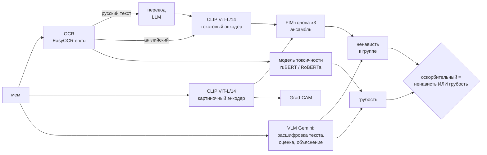

# MemeGuard: мультимодальный детектор оскорбительных мемов

Capstone-проект курса AI Engineer. Система смотрит на мем целиком (картинку и текст на ней),
ищет в нём ненависть к группе людей и грубость, показывает, куда смотрела модель, и объясняет
решение по-русски.

**Демо:** https://memeguard-kappa.vercel.app (модель работает, пока запущен `scripts/start_demo.sh`)

**Почему задача нетривиальная.** Оскорбление в меме часто живёт не в картинке и не в тексте,
а в их сочетании: подпись «look how many people love you» безобидна на фото пустыни и
оскорбительна на фото людей определённой группы. Поэтому ни картиночный, ни текстовый
классификатор по отдельности задачу не решают.

## Как устроено



| Направление | Что используется |
|---|---|
| **CV** | CLIP ViT-L/14 (картинки), EasyOCR, Grad-CAM для ViT |
| **NLP** | CLIP (текст), модели токсичности (ruBERT, RoBERTa), VLM-промптинг: zero-shot классификация, объяснения, перевод и расшифровка подписей |
| **ML** | голова FIM (матрица взаимодействия признаков, Hate-CLIPper), ансамбль, сравнение 4 голов на 2 бэкбонах |

## Результаты

Датасет [Hateful Memes](https://arxiv.org/abs/2005.04790) (Facebook AI): 8500 train, 500 dev.
Метрика AUROC на dev; порог и ранняя остановка подбираются на отложенных 10% train, dev только для оценки.

| Модель | AUROC dev |
|---|---|
| Zero-shot CLIP ViT-B/32 (часть 1) | 0.601 |
| CLIP ViT-B/32 + MLP (часть 1, лучший результат) | 0.698 |
| Совместная модель со взаимным вниманием (часть 2) | 0.679 |
| ViT-L/14 + LogReg | 0.710 |
| **MemeGuard: ViT-L/14 + FIM, ансамбль из 3** | **0.737** |
| то же, но с текстом из OCR вместо разметки | 0.727 |
| Qwen3-VL 8B zero-shot (локально, без обучения) | 0.706 |
| Gemini Flash-Lite zero-shot (без обучения) | 0.759 |
| MemeGuard + Qwen3-VL (среднее, полностью офлайн) | 0.772 |
| **MemeGuard + Gemini (среднее, как в демо)** | **0.811** |

VLM-оценки сравниваются на 497 мемах dev (на 3 мемах Gemini отказался отвечать).
Вес ансамбля 0.5 не подбирался на dev.

**Два слоя.** Hateful Memes считает оскорбительным только ненависть к группе людей, а мат
и хамство разметчики специально помечали как норму, поэтому обученная на нём модель грубость
не ловит. В продукте мем считается оскорбительным, если в нём есть ненависть к группе
**или** грубость. Для второго слоя используются предобученные модели токсичности текста
(`cointegrated/rubert-tiny-toxicity` для русского, `s-nlp/roberta_toxicity_classifier`
для английского) и мнение VLM.

**Русскоязычные мемы** (84 мема: 60 случайных из Kaggle-набора и 26 собранных вручную,
разметка по определению продукта, 35 оскорбительных):

| Вариант | AUROC [95% ДИ] | поймано | зря забанено |
|---|---|---|---|
| только классификатор ненависти (с переводом) | 0.50 [0.37; 0.62] | 20% | 20% |
| только грубость, текст EasyOCR | 0.59 [0.47; 0.71] | 20% | 12% |
| только грубость, текст VLM | 0.62 [0.50; 0.74] | 34% | 22% |
| **система как в демо (с мнением VLM)** | **0.63 [0.51; 0.74]** | **60%** | 41% |

Классификатор ненависти, обученный на американских мемах, на русские не переносится, и дообучение
на ~70 русских мемах не помогло. Основной сигнал даёт слой грубости, и для него критично качество
OCR. Для реальной модерации на русском нужна нормальная разметка.

Находки по ходу работы:
- **Баг QuickGELU.** `open_clip` по имени `ViT-L-14` собирает модель с обычной GELU, а веса OpenAI
  обучены с QuickGELU (нужно имя `ViT-L-14-quickgelu`). Исправление дало +0.01..0.02 AUROC.
- **Сравнение prompting и обучения** (VLM zero-shot против обученной головы) и их ансамбль в
  [proj_3.ipynb](proj_3.ipynb), раздел 8.
- **Определение задачи важнее архитектуры:** Hateful Memes не считает грубость оскорблением,
  поэтому понадобился второй слой (раздел 10).
- **Русскоязычные мемы**, разметка и перенос в разделе 11.

Подробности, графики и выводы (главный ноутбук **proj_3.ipynb**):
[proj_1.ipynb](proj_1.ipynb) (EDA, эмбеддинги, классификаторы),
[proj_2.ipynb](proj_2.ipynb) (совместная модель, дообучение CLIP, Memotion),
[proj_3.ipynb](proj_3.ipynb) (итоговая модель, баг, OCR, VLM, Grad-CAM, русские мемы).

## Запуск

Нужен Python 3.11.

```bash
python3.11 -m venv .venv
source .venv/bin/activate
pip install -r requirements.txt
```

Создайте `.env` в корне проекта (ключ Gemini бесплатный, выдаётся в https://aistudio.google.com/apikey):

```
LLM_PROVIDER=gemini
GEMINI_API_KEY=...
```

Без ключа всё работает, кроме объяснений VLM.

### Демо

```bash
python app.py                    # Gradio на http://127.0.0.1:7860
```

или в Docker:

```bash
docker build -t memeguard .
docker run -p 7860:7860 --env-file .env memeguard
```

Сайт (`frontend/`, статический, деплоится на Vercel) обращается к Gradio-приложению по API.
Модель весит около 2 ГБ, бесплатные облачные хостинги её не вмещают, поэтому на время показа
она запускается на ноутбуке и открывается наружу туннелем Cloudflare. Всё это делает одна команда:

```bash
bash scripts/start_demo.sh       # нужны cloudflared и vercel login
```

Туннелей два: сначала Cloudflare, а если сеть блокирует его порт 7844 (так бывает в сетях
вузов и офисов), скрипт автоматически переключается на localhost.run через ssh.

### Мониторинг

Каждый запрос к демо пишется в `logs/requests.jsonl` (`memeguard/monitoring.py`): время каждого
шага, какая модель Gemini ответила, ошибки и лимиты, расхождение классификатора и VLM, исправил ли
VLM текст OCR. Картинки и тексты мемов не сохраняются. Сводка видна на сайте (раздел «Мониторинг»)
и в Gradio. По журналу видно, что узкое место VLM: OCR, CLIP и токсичность вместе занимают меньше
секунды, объяснение VLM около 10-15 секунд.

### Воспроизведение экспериментов

Датасет Hateful Memes распространять нельзя, его нужно скачать самостоятельно
(например, с Kaggle) и распаковать в `data/` (`data/img/`, `data/train.jsonl`, `data/dev.jsonl`, `data/test.jsonl`).

```bash
python scripts/extract_clip_features.py --model ViT-L-14-quickgelu --tag vitl14q   # ~15 мин на M-серии
python scripts/extract_clip_features.py --model ViT-B-32-quickgelu --tag vitb32q
python scripts/train_heads.py                       # сравнение голов, сохраняет models/
python scripts/ocr_dev.py                           # OCR по dev
python scripts/vlm_zero_shot.py --provider gemini --model gemini-flash-lite-latest
python scripts/vlm_zero_shot.py --provider ollama --model qwen3-vl:8b-instruct     # нужна ollama
```

Для локальной VLM нужна [Ollama](https://ollama.com) и модель `ollama pull qwen3-vl:8b-instruct`.

Русскоязычные мемы из двух источников:
- 684 обычных мема из Kaggle-датасета
  [Memes in Russian](https://www.kaggle.com/datasets/lexusbedra/memes-in-russian-picture-dataset)
  (без разметки, распаковать в `data/russian memes/`);
- оскорбительные мемы, собранные вручную, в `data/ru_memes/img/`.

`python scripts/make_ru_labels.py` прогоняет EasyOCR и составляет список мемов,
`python scripts/vlm_ocr.py` расшифровывает текст локальной VLM,
`python scripts/label_one.py` открывает разметку в браузере (60 случайных мемов, по одному,
две кнопки; метки в `data/ru_memes/labels_v2.csv`), затем
`python scripts/ru_experiments.py` считает все варианты, включая дообучение с кросс-валидацией.

## Структура

```
memeguard/          пакет: OCR, головы, пайплайн инференса + Grad-CAM, VLM, токсичность, мониторинг
scripts/            извлечение признаков, обучение, эксперименты, деплой
models/             веса итогового ансамбля голов (9 МБ x 3) и конфиг
reports/            таблицы результатов экспериментов
frontend/           сайт для Vercel (HTML + JS, без сборки)
app.py              Gradio-приложение
proj_1..3.ipynb     ноутбуки с анализом
```

## Ограничения

- Датасет англоязычный и американский по контексту; на русских мемах без перевода модель почти слепа.
- Разметка «hateful» субъективна; модель стоит использовать как фильтр первой линии, а не как судью.
- Бесплатные API ограничены по числу запросов в день.
- Датасет Hateful Memes доступен только для исследований, в репозитории его нет.
